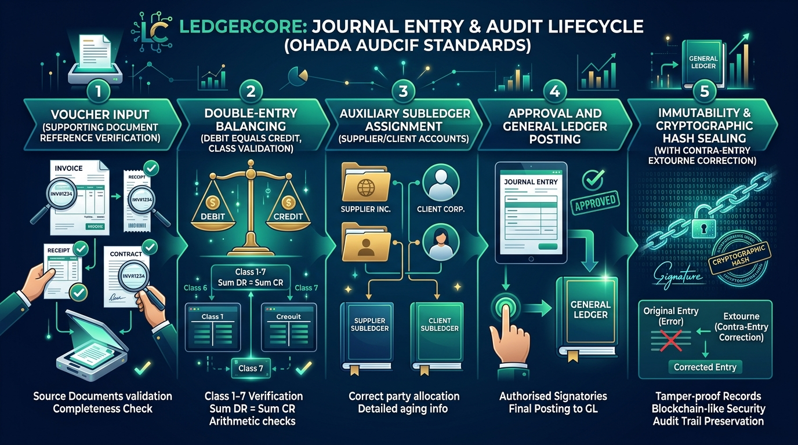

# LedgerCore Health — Role Guide: Accounting Clerk
**Operational Voucher Capture, Supplier Invoicing & Cash Desk Operations**  
*SYSCOHADA Revised / AUDCIF Standards*

---

*Figure 1: LedgerCore Journal Entry & Audit Lifecycle under OHADA AUDCIF Standards — From Voucher Input and Double-Entry Balancing to Auxiliary Subledger Allocation, General Ledger Posting, and Tamper-Proof Cryptographic Hash Sealing.*

---

## 1. Role Scope & Primary Responsibilities
As an **Accounting Clerk (*Aide-Comptable / Saisisseur*)**, you are responsible for day-to-day transaction processing:
- 📝 Capturing supplier bills and service invoices in specialized journals.
- 🩺 Processing patient consultation and hospital service billing.
- 💵 Recording petty cash disbursements and Mobile Money collection receipts.
- 🔤 Matching payments to invoices (*Lettrage*).
- ⚖️ Ensuring every captured voucher complies with **AUDCIF Article 17** (mandatory supporting document, balanced double-entry, no negative numbers).

---

## 2. Step-by-Step Procedure: Capturing a Journal Voucher

### Step 2.1: Sign In & Open the Entry Form
1. 🔑 **Sign In:** Use your clerk credentials (Demo: `amina.bakari@hgy.cm` / `Ledger@2026`).
2. 📝 **Navigate to Journal:** Go to **Accounting -> Journal Entries** (`/journal`).
3. ➕ **Open Form:** Click the **+ New Entry** button.

### Step 2.2: Fill the Header Information
- 📚 **Journal Code:** Choose the appropriate specialized journal:
  - `ACH` for Supplier purchases (pharmaceuticals, medical reagents, surgical consumables).
  - `VTE` for Patient billing, surgery packages, consultation revenues.
  - `BQ` for Bank transactions (deposits, transfers, fees).
  - `CA` for Cash desk and petty cash receipts.
  - `OD` for Miscellaneous adjustments and accruals.
- 📅 **Entry Date:** The date indicated on the paper receipt or supplier invoice (must fall in an open period).
- 🏷️ **Reference \* (Mandatory under AUDCIF Art. 17):** Enter the exact invoice number (e.g., `FAC-2026-0819`) or receipt voucher reference. Leaving this field blank is prohibited by the validation engine.
- 📄 **Description:** Clear, concise summary of the transaction (e.g., `Fourniture compresse et gants stériles - BioMed`).

### Step 2.3: Populate Journal Lines (Minimum 2 Balanced Lines)
1. 📈 **Debit Line (Expense or Asset):**
   - In the **Account** field, search by code or name (e.g., `6011 — Fournitures médicales`).
   - Enter the debit amount (e.g., `250,000.00`).
   - For all Class 6 expense accounts, select the relevant **Cost Centre** (e.g., `Surgery Ward`, `ICU`, `Central Pharmacy`).
2. 📉 **Credit Line (Counterpart / Payable):**
   - Search for the balancing account (e.g., `4011 — Fournisseurs`).
   - Enter the credit amount (e.g., `250,000.00`).
   - **Auxiliary Third Party:** For collective accounts (`4011`, `4111`), select the individual supplier or client from the dropdown (e.g., `[FRN] Air Liquide Santé`).
3. ⚖️ **Verify Equilibrium:** Look at the bottom right. The **Out of balance** counter must read `0.00` in green.
4. 💾 **Save:** Click **Save as Draft**. The entry is saved and queued for the Chief Accountant's review and posting.

---

## 3. How to Use the Intelligent Counterpart Engine
When capturing routine hospital transactions, you do not need to look up every credit account manually:
1. ✍️ Enter the first line (e.g., Account `6051 — Électricité` for `250,000 XAF`).
2. 💡 Click **Propose Counterpart** (or let auto-suggest trigger).
3. 🤖 The engine suggests the standard counterpart (e.g., Account `4011` or `5211`) based on previous hospital entries.
4. 🔍 Review, adjust the third party if needed, and click save.

---

## 4. Step-by-Step Procedure: Open-Item Lettrage & Invoice-Payment Matching
When a supplier is paid or a patient bill is cleared:
1. 📖 Navigate to **Accounting -> General Ledger** (`/ledger`).
2. 👥 Select the third-party account (e.g., `401100 — Fournisseurs`).
3. 🔍 Click the **Lettrage** tab and filter for **Unmatched (*Non-lettrées*)**.
4. ☑️ Check the box on the original invoice credit line and the bank payment debit line.
5. ⚖️ Confirm that total selected debits equal total selected credits ($\Delta = 0.00$).
6. 🔤 Click **Match Selected Lines (Lettrer)**. The system assigns a matching letter (`AA`, `AB`...) confirming the item is fully settled and cleared.

---

## 5. Important Statutory Rules to Remember
> [!IMPORTANT]
> - 🚫 **Never enter negative amounts.** Under OHADA AUDCIF rules, negative entries are invalid. If you need to reduce an amount, invert the debit and credit sides.
> - 🚫 **Never post to heading accounts (2 or 3 digits).** Always select a 4-to-8 digit operational account (e.g., `601100`, not `60` or `601`).
> - 📄 **Always attach a reference.** If you do not have an official supplier invoice number, use the internal voucher number generated by procurement.
