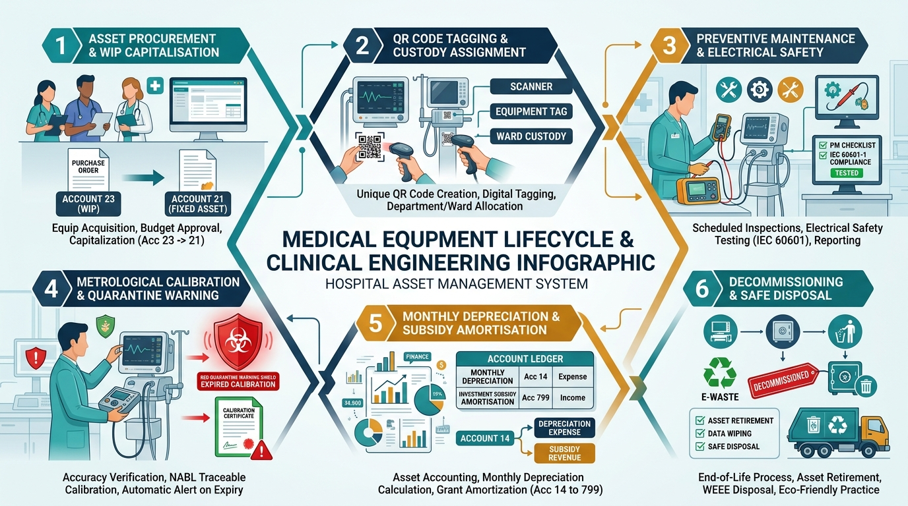
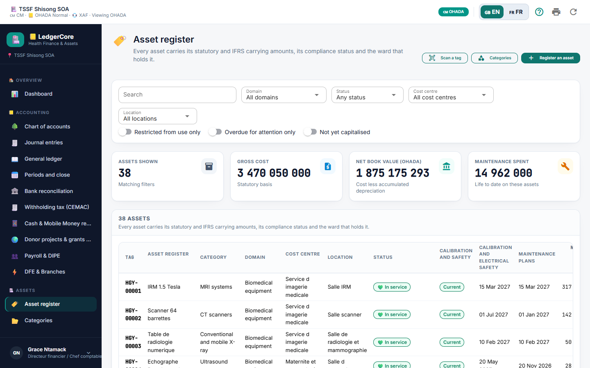
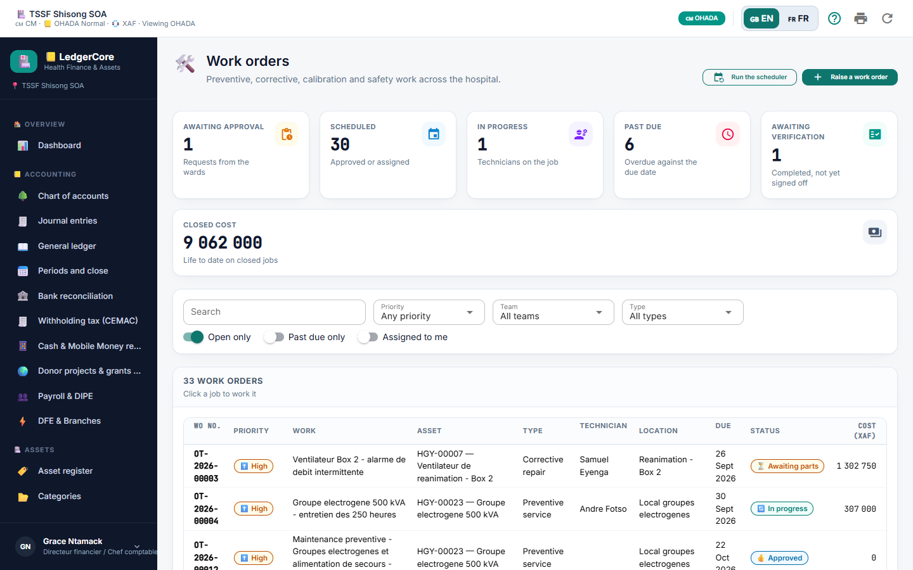
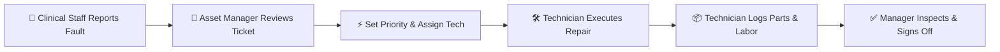
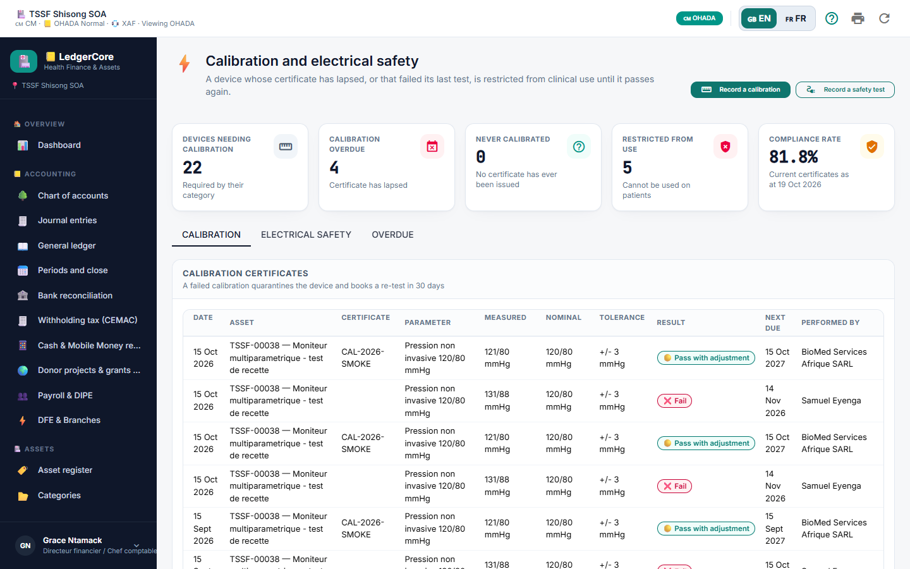
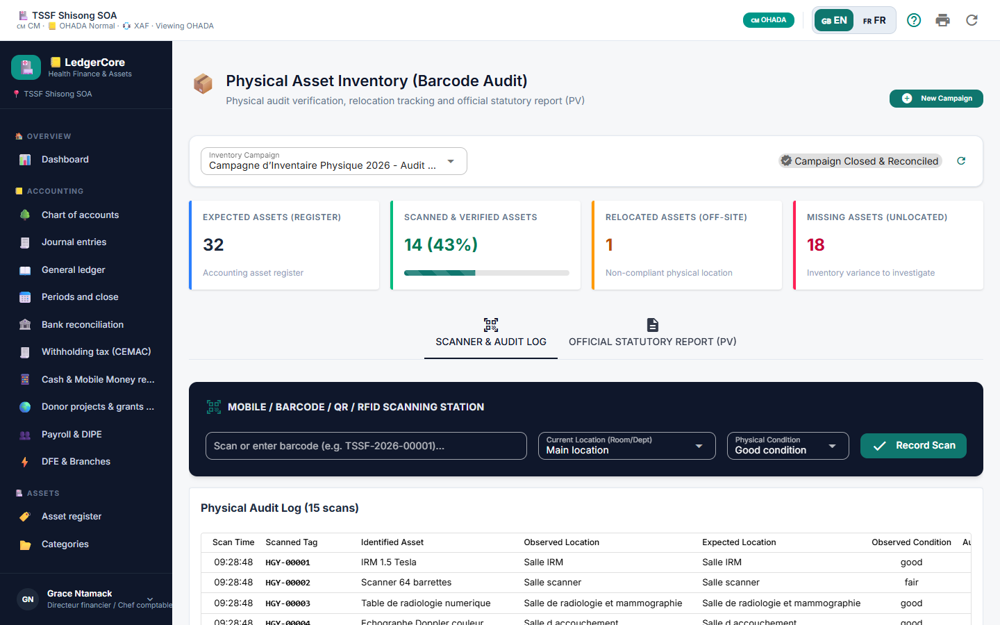

# LedgerCore Health — Role Guide: Biomedical & Asset Manager
**Medical Equipment Lifecycle, CMMS Maintenance & Regulatory Safety**  
*IEC 60601 Electrical Safety & Metrological Calibration Compliance*

---

*Figure 1: Medical Equipment Lifecycle & Clinical Engineering Infographic — 6 integrated stages: Procurement & WIP Capitalisation, QR Tagging, Maintenance & Electrical Safety, Calibration & Quarantine Warning, Depreciation & Subsidy Amortisation, and Decommissioning.*

---

## 1. Role Scope & Primary Responsibilities
As the **Biomedical Engineer & Asset Manager**, you bridge clinical technology and financial stewardship:
- 🏷️ Registering new biomedical, facility, IT, and vehicle assets.
- 📱 Generating and affixing durable waterproof QR code identification tags.
- 📅 Scheduling and supervising preventive maintenance cycles.
- 🚨 Triaging breakdown requests and assigning corrective work orders.
- ⚡ Enforcing electrical safety compliance (**IEC 60601-1**) and metrological calibration.
- 🛑 Quarantining uncalibrated or unsafe equipment to protect patient health.
- 📦 Conducting annual physical inventory campaigns and reconciling against the General Ledger.

---

## 2. Step-by-Step Procedure: Registering New Medical Equipment

*Figure 2: Fixed Asset Register — Detailed Inventory with Serial Numbers, Acquisition Costs, Carrying Amounts, and Calibration Indicators.*

1. 🔑 **Sign In:** Log in with your authorized asset manager credentials.
2. 🏷️ **Navigate to Register:** Go to **Assets -> Register** (`/assets`) and click **+ Register Asset**.
3. 📝 **Enter General Information:**
   - **Asset Name:** Official equipment description (e.g., `Hamilton-C3 Intensive Care Ventilator`).
   - **Domain:** Select `Biomedical`.
   - **Category:** Select the appropriate category (e.g., `Medical & Surgical Equipment`).
   - **Serial Number & Model:** Essential for regulatory traceability (e.g., `SN-HAM-2026-9041`).
   - **Manufacturer & Supplier:** Select from the vendor lookup (e.g., `Hamilton Medical`).
4. 💰 **Configure Financial Valuation:**
   - **Acquisition Cost:** Invoice gross amount in XAF (e.g., `18,500,000`).
   - **Acquisition Date:** Date of receipt and clinical commissioning.
   - **Depreciation Lifetime:** Default derived from category (e.g., 5 years = 60 months).
   - **Funding Source:** Select `Own Funds` or `Donor Grant / Investment Subsidy`.
5. 🏥 **Assign Location & Custody:**
   - **Department / Ward:** Assign to clinical unit (e.g., `Intensive Care Unit (ICU)`).
   - **Room / Location:** Specific room number (e.g., `ICU Bed 4`).
   - **Custodian:** Assign to the supervising ward head.
6. 🏷️ **Save & Tag:** Click **Save Asset**. Click **Print QR Tag** to generate the waterproof barcode label to affix directly to the machine chassis.

---

## 3. Maintenance Plans & Work Orders Workflow

*Figure 3: Work Orders Pipeline — Reviewing Queued Tickets, Technician Status, and Direct Clinical Costs.*

### Step-by-Step Procedure: Triaging Work Orders
1. 🛠️ **Open Work Orders:** Navigate to **Maintenance -> Work Orders** (`/maintenance`).
2. 🔍 **Review Queue:** Review newly reported issues under `Awaiting Approval`.
3. 🎯 **Set Priority Level:**
   - 🔴 **Critical / Emergency:** Direct patient life support (ventilators, defibrillators, surgical anaesthesia units).
   - 🟠 **High:** Diagnostic imaging or lab analysers.
   - 🟡 **Medium / Low:** Administrative IT or non-critical furniture.
4. 👷 **Assign Technician:** Assign to an active Biomedical Technician from the personnel list.

---

## 4. Electrical Safety (IEC 60601) & Metrological Calibration

*Figure 4: Calibration and Electrical Safety Dashboard — Monitoring Equipment Certificates, Metrological Tests, and Enforcing Clinical Quarantine.*

Patient safety demands strict adherence to international biomedical testing standards:

1. 🩺 Open the asset card under **Assets -> Register** (`/assets`).
2. ⚡ Click the **Safety & Calibration** tab.
3. 🔌 **Electrical Safety Test (IEC 60601-1):**
   - Record Protective Earth Resistance ($\le 0.2\ \Omega$).
   - Record Earth Leakage Current ($\le 500\ \mu\text{A}$ in normal condition).
   - Record Patient Leakage Current ($\le 10\ \mu\text{A}$ for CF applied parts).
4. 📐 **Metrological Calibration:**
   - Enter the calibration date, testing laboratory, and certificate expiry date.
   - Upload the scanned calibration certificate PDF.
5. 🛑 **Automatic Quarantine Flag:**
   - If an electrical safety test fails, or if the calibration expiry date passes, LedgerCore automatically applies a **Quarantine / Restriction Flag**.
   - The device is highlighted in red on the clinical dashboard, prohibiting scheduling for patient care until re-certified.

---

## 5. Step-by-Step Procedure: Executing Physical Inventory Campaigns

*Figure 5: Physical Asset Inventory Sweep — Scanning Barcodes and Reconciling Displaced or Missing Hospital Assets.*

1. 📦 Navigate to **Assets -> Physical Inventory** (`/asset-inventory`).
2. ➕ Click **+ New Inventory Campaign** (e.g., `Annual Inventory 2026 - West Wing`).
3. 📱 Take a mobile tablet with a camera or barcode scanner through the wards.
4. 🔍 Scan each asset's QR code. The app automatically marks it **Verified**.
5. 📊 After completing the sweep, review the **Variance Report**:
   - 📍 **Displaced Assets:** Equipment found in a different room than registered. Click **Update Location** to reconcile.
   - ❓ **Missing Assets:** Equipment not scanned during the audit. Review with department heads before initiating insurance or accounting write-offs.
