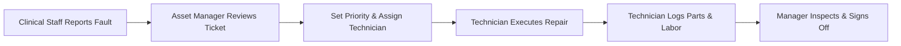

# LedgerCore Health — Role Guide: Biomedical & Asset Manager
**Medical Equipment Lifecycle, CMMS Maintenance & Regulatory Safety**  
*IEC 60601 Electrical Safety & Metrological Calibration Compliance*

---

## 1. Role Scope & Primary Responsibilities
As the **Biomedical Engineer / Asset Manager (*Responsable Biomédical et Gestionnaire des Immobilisations*)**, you bridge clinical technology and financial stewardship:
- Registering new biomedical, facility, IT, and fleet assets.
- Generating and affixing durable QR code identification tags.
- Scheduling and supervising preventive maintenance plans.
- Triaging breakdown requests and assigning corrective work orders.
- Enforcing electrical safety compliance (IEC 60601) and calibration standards.
- Quarantining uncalibrated or unsafe equipment to protect patient health.
- Conducting annual physical inventory campaigns and reconciling against the General Ledger.

---

## 2. Registering New Medical Equipment
1. Log in with your asset manager credentials (Demo: `fatou.diallo@hgy.cm` / `Ledger@2026`).
2. Navigate to **Assets -> Register** and click **+ Register Asset**.
3. **General Information:**
   - **Asset Name:** Official equipment description (e.g., `Ventilateur de Réanimation Hamilton-C3`).
   - **Domain:** Select `Biomedical`.
   - **Category:** Select the appropriate category (e.g., `Matériel Médical & Chirurgical`).
   - **Serial Number & Model:** Essential for regulatory traceability.
   - **Manufacturer & Supplier:** Select from the vendor lookup.
4. **Financial Valuation:**
   - **Acquisition Cost (Valeur d'Acquisition):** Invoice amount in XAF.
   - **Acquisition Date:** Date of receipt and commissioning.
   - **Depreciation Lifetime:** Default derived from category (e.g., 5 years = 60 months).
   - **Funding Source:** Select `Own Funds` or `Donor Grant / Investment Subsidy`.
5. **Location & Custody:**
   - **Department / Ward:** Assign to clinical unit (e.g., `Intensive Care Unit`).
   - **Room / Location:** Specific room number (e.g., `ICU Bed 4`).
   - **Custodian:** Assign to the supervising ward head.
6. **Save & Tag:** Click **Save Asset**. Click **Print QR Tag** to generate the waterproof barcode label to affix directly to the machine chassis.

---

## 3. Maintenance Plans & Work Orders Workflow

### Triaging Work Orders:
1. Open **Maintenance -> Work Orders**.
2. Review newly reported issues under `Awaiting Approval`.
3. Set priority level:
   - **Critical / Emergency:** Direct patient life support (ventilators, defibrillators, surgical anaesthesia units).
   - **High:** Diagnostic imaging or lab analysers.
   - **Medium / Low:** Administrative IT or non-critical furniture.
4. Assign to a Biomedical Technician (e.g., `samuel.eyenga@hgy.cm`).

---

## 4. Electrical Safety (IEC 60601) & Metrological Calibration
Patient safety demands strict adherence to international biomedical testing standards:

1. Open the asset card under **Assets -> Register**.
2. Click the **Safety & Calibration** tab.
3. **Electrical Safety Test (IEC 60601-1):**
   - Record Protective Earth Resistance ($\le 0.2\ \Omega$).
   - Record Earth Leakage Current ($\le 500\ \mu\text{A}$ in normal condition).
   - Record Patient Leakage Current ($\le 10\ \mu\text{A}$ for CF applied parts).
4. **Metrological Calibration:**
   - Enter the calibration date, testing laboratory, and certificate expiry date.
   - Upload the scanned calibration certificate PDF.
5. **Automatic Quarantine Flag:**
   - If an electrical safety test fails, or if the calibration expiry date passes, LedgerCore automatically applies a **Quarantine / Restriction Flag**.
   - The device is highlighted in red on the clinical dashboard, prohibiting scheduling for patient care until re-certified.

---

## 5. Physical Inventory Campaigns
1. Go to **Assets -> Physical Inventory**.
2. Click **New Inventory Campaign** (e.g., `Annual Inventory 2026 - West Wing`).
3. Take a tablet with a barcode scanner through the wards.
4. Scan each asset's QR code. The app automatically marks it **Verified**.
5. After completing the sweep, review the **Variance Report**:
   - **Displaced Assets:** Equipment found in a different room than registered. Click **Update Location** to reconcile.
   - **Missing Assets:** Equipment not scanned during the audit. Review with department heads before initiating insurance or accounting write-offs.
