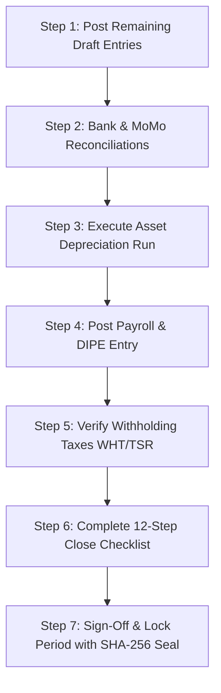

# LedgerCore Health — Role Guide: CFO & Chief Accountant
**Strategic Financial Governance, Statutory Reporting & Compliance**  
*SYSCOHADA Revised / AUDCIF & IFRS Standards*

---

## 1. Role Scope & Primary Responsibilities
As the **Chief Financial Officer (CFO)** or **Chief Accountant (*Chef Comptable*)**, you hold overall authority over the hospital's financial spine:
- Reviewing and posting journal entries prepared by accounting clerks.
- Executing monthly and annual asset depreciation runs.
- Monitoring real-time treasury positions across commercial banks and Mobile Money accounts.
- Overseeing the structured 12-step month-end closing procedure.
- Reviewing and signing off on OHADA statutory financial statements (Bilan, Compte de Résultat, TAFIRE) and international IFRS presentations.
- Generating the dematerialized electronic tax audit file (*FEC - Fichier des Écritures Comptables*).

---

## 2. Daily Workflow
1. **Sign In:** Use your authorized credentials (Demo account: `grace.ntamack@hgy.cm` / `Ledger@2026`).
2. **Review Executive Dashboard:**
   - Check the **Year-to-Date Net Result** (Surplus/Deficit).
   - Review the **Draft Entries Counter**: If drafts are awaiting approval, click directly to review.
   - Inspect bank and liquidity balances.
3. **Review & Post Journal Entries:**
   - Navigate to **Accounting -> Journal Entries**.
   - Filter by `Status: Draft`.
   - Open each voucher, verify that total debits equal total credits, check that a valid supporting document (*Pièce justificative*) is referenced, and verify analytical cost center assignments.
   - Click **Post to Ledger** to commit the entry.

---

## 3. Month-End Financial Close Procedure

Follow this strict chronological sequence to ensure full compliance with **AUDCIF Articles 13 & 20**:

### Detailed Steps:
1. **Depreciation Run:**
   - Go to **Assets -> Depreciation**.
   - Click **Run Depreciation**. Choose the month being closed.
   - Review the calculation preview. Click **Post Run**. The system automatically creates a balanced voucher in Journal `AMO` with zero manual calculation needed.
   - If donor-funded assets exist, verify the simultaneous write-back of investment subsidies (Accounts `14` -> `799`).
2. **Bank & Cash Reconciliation:**
   - Go to **Accounting -> Bank Reconciliation**.
   - Ensure the bank statement closing balance matches the general ledger cash book with zero unexplained variance.
3. **Period Close Execution:**
   - Go to **Accounting -> Periods**.
   - Click on the active period (e.g., `2026-09`).
   - Work through the **12-Step Close Checklist**. Tick each completed item.
   - Click **Close Period**. This prevents clerks from entering further transactions.
   - Once the external audit or senior sign-off is complete, click **Lock Period** to trigger the **SHA-256 cryptographic hash seal**.

---

## 4. Handling Error Corrections & Reversals (*Extourne*)
In compliance with **AUDCIF Article 20**, posted journal entries cannot be edited or deleted:
1. Locate the erroneous entry under **Accounting -> Journal Entries**.
2. Click **Reverse Entry**.
3. Select the reversal date and enter a comprehensive justification (minimum 5 characters).
4. Click **Confirm Reversal**.
5. LedgerCore generates a contra-entry, linking both transactions for external auditors.

---

## 5. Generating Statutory & Tax Reports
- **Bilan & Compte de Résultat:** Navigate to **Reporting -> Financial Statements**. Toggle between **OHADA** and **IFRS** views. Export to PDF or Excel.
- **FEC Export:** In **Reporting -> FEC Export**, generate the 18-column dematerialized journal file compliant with CEMAC tax administration requirements.
