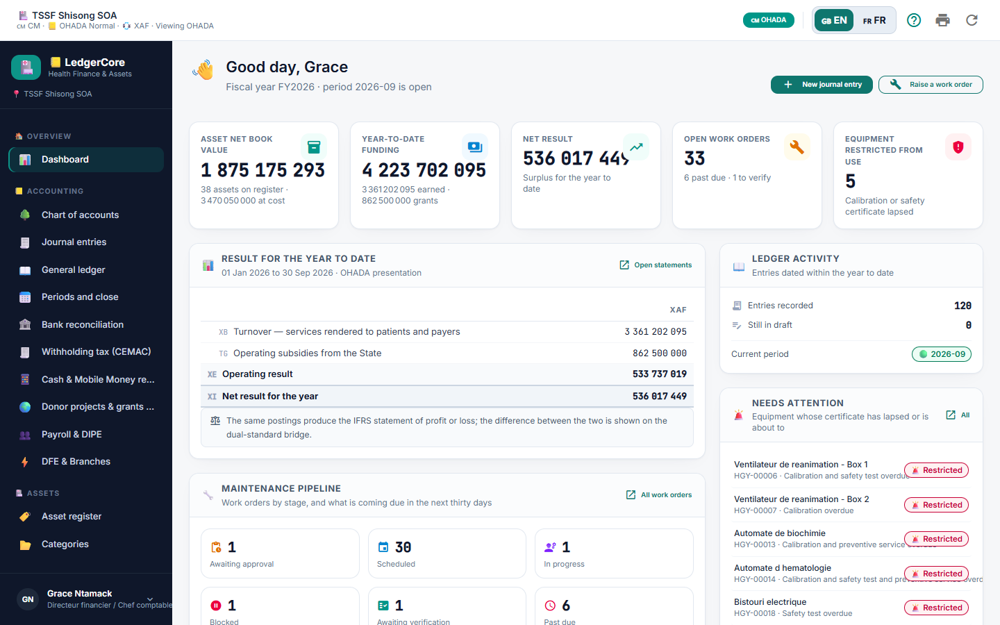
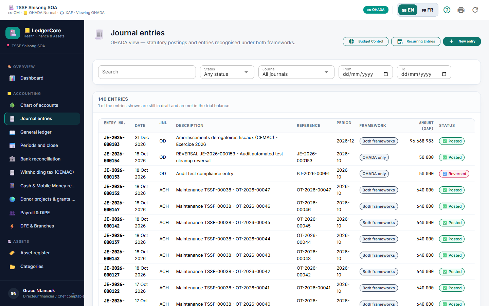
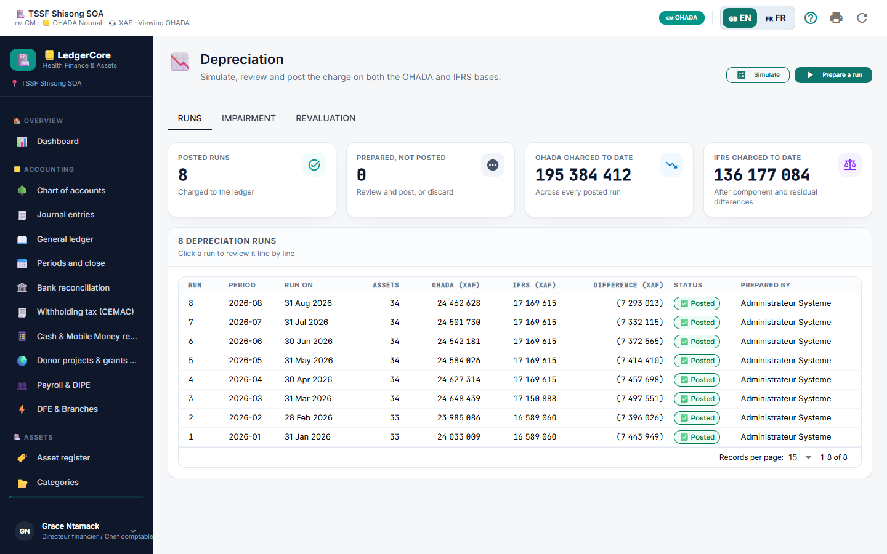

# LedgerCore Health — Role Guide: CFO & Chief Accountant
**Strategic Financial Governance, Statutory Reporting & Compliance**  
*SYSCOHADA Revised / AUDCIF & IFRS Standards*

---

*Figure 1: 12-Step Month-End Closing Procedure & Cryptographic SHA-256 Hash Chaining in LedgerCore Health.*

---

## 1. Role Scope & Primary Responsibilities
As the **Chief Financial Officer (CFO)** or **Chief Accountant**, you hold overall authority over the hospital's financial spine:
- ✍️ Reviewing and posting journal entries prepared by accounting clerks.
- 📉 Executing monthly and annual asset depreciation runs.
- 🏦 Monitoring real-time treasury positions across commercial banks and Mobile Money accounts.
- 🔒 Overseeing the structured 12-step month-end closing procedure.
- 📊 Reviewing and signing off on statutory financial statements (Balance Sheet, Income Statement, Statement of Cash Flows) and international IFRS presentations.
- 📄 Generating the dematerialized electronic tax audit file (FEC - Accounting Entries Audit File).

---

## 2. Daily Workflow: Reviewing & Posting Journal Vouchers

*Figure 2: Executive Financial Dashboard — Monitoring Surplus/Deficit, Asset Net Book Value, and Uncommitted Draft Vouchers in Real Time.*

*Figure 3: Journal Entry & Audit Lifecycle under OHADA AUDCIF Standards.*

*Figure 4: Journal Entries Workspace — Reviewing Drafts, Validating Supporting Vouchers, and Committing Entries to the General Ledger.*

### Step-by-Step Procedure:
1. 🔑 **Sign In:** Sign in with your authorized CFO / Chief Accountant credentials.
2. 📊 **Review Executive Dashboard:**
   - Check the **Year-to-Date Net Surplus** (Surplus/Deficit).
   - In the **Ledger Activity** card, observe the **Still in draft** counter. Click directly on it to view uncommitted vouchers.
3. 🔎 **Inspect Draft Vouchers:**
   - Go to **Accounting -> Journal Entries** (`/journal`).
   - Set the filter `Status: Draft`.
   - Click on a draft voucher to open its detail view.
4. ⚖️ **Audit Statutory Compliance:**
   - **AUDCIF Art. 17 Check:** Ensure the **Reference \*** field contains an authentic supporting document identifier (e.g., `FAC-2026-9901`).
   - **Equilibrium Check:** Confirm Total Debits equal Total Credits.
   - **Posting Level Check:** Confirm that no lines are posted to 2-digit or 3-digit heading accounts.
   - **Cost Centre & Partner Check:** Verify that expense lines carry an analytical cost centre and collective accounts (`401`, `411`) have an assigned third-party partner.
5. 🚀 **Post to Ledger:**
   - Click **Post to ledger** (`task_alt` icon).
   - The entry status transitions from `draft` to `posted`, a sequential entry number is permanently sealed, and the General Ledger running balance updates immediately.

---

## 3. Month-End Financial Close Procedure

Follow this strict chronological sequence to ensure full compliance with **AUDCIF Articles 13 & 20**:

*Figure 5: Accounting Periods & Month-End Close Screen — Checking Off Verifications and Locking the Ledger.*

### Detailed Step-by-Step Instructions:

#### Step 3.1: Execute Monthly Asset Depreciation Run
1. 📉 Navigate to **Assets -> Depreciation** (`/depreciation`).
2. ⚙️ Click **Run Depreciation**. Choose the fiscal period (e.g., `September 2026`).
3. 🔍 Click **Simulate**. Review the calculated lines:
   - Verify straight-line and degressive depreciation charges.
   - Confirm investment subsidy write-backs (Account `14` $\to$ `799`).
4. 🚀 Click **Post Run**. The system commits the balanced entry to Journal `AMO`.

*Figure 6: Asset Depreciation Workspace — Dual-Method Calculation and Subsidy Write-Back Simulation.*

#### Step 3.2: Verify Bank & Mobile Money Reconciliations
1. 🏦 Navigate to **Accounting -> Bank reconciliation** (`/bank-reconciliation`).
2. 💳 For each bank account and Mobile Money desk:
   - Confirm that the electronic statement closing balance matches the cash book closing balance.
   - Ensure the **Unreconciled Variance** displays `0.00 XAF`.
   - Click **Sign Off Reconciliation**.

#### Step 3.3: Complete the 12-Step Period Close Checklist
1. 📅 Navigate to **Accounting -> Periods and close** (`/periods`).
2. 🔎 Click on the active period (e.g., `2026-09`).
3. ✅ Work through and check off each completed item:
   - [x] Step 1: All draft entries verified and posted or deleted.
   - [x] Step 2: Bank and Mobile Money reconciliations completed with zero variance.
   - [x] Step 3: Cash desk registers audited and vault transfers verified.
   - [x] Step 4: Monthly asset depreciation run posted to Journal `AMO`.
   - [x] Step 5: Monthly payroll wage entry posted and reconciled against social declarations (DIPE).
   - [x] Step 6: Withholding taxes (WHT/TSR) reconciled and certificates generated.
   - [x] Step 7: Patient billing reconciled against pharmacy/ward consumption.
   - [x] Step 8: Foreign currency accounts revalued at month-end closing exchange rates.
   - [x] Step 9: Inter-branch reciprocal accounts (`181`/`185`) reconciled.
   - [x] Step 10: Physical inventory adjustments booked.
   - [x] Step 11: Departmental cost allocations reviewed.
   - [x] Step 12: Trial balance equilibrium confirmed.
4. 🔒 Click **Close Period**. General journal capture is now locked for all standard clerks.
5. 🔐 For year-end finalization, click **Lock Period (Final Seal)** to generate the permanent **SHA-256 cryptographic seal**.

---

## 4. Closed Period Overrides & Governance

If an extraordinary post-closing adjustment is legally required by external auditors:
1. 🛡️ Ensure your account holds the `journal.post_closed` permission.
2. 📝 When capturing or posting the entry into a closed period, a mandatory **Override Reason Dialog** will prompt you.
3. ✍️ Enter an audit justification of at least 10 characters (e.g., `Statutory Auditor Audit Adjustment - Litigation Provision`).
4. 🔒 LedgerCore records the entry with `closed_period_override = 1`, logs your user ID as `override_by`, and generates an indelible entry in the forensic audit trail.

---

## 5. Handling Error Corrections & Reversals (Contra-Entry)

In strict compliance with **AUDCIF Article 20**, deleting or altering a posted journal entry is illegal.

### Reversal Procedure:
1. 🔍 Open the posted journal voucher in **Journal Entries** (`/journal`).
2. ↩️ Click **Reverse Entry** in the entry modal footer.
3. 📅 Confirm the accounting reversal date (defaults to current date).
4. 📝 Provide an audit explanation (minimum 5 characters, e.g., `Correction of analytical account allocation error`).
5. 🚀 Click **Reverse entry**. The system commits the inverted double-entry and links both records in the audit trail.
