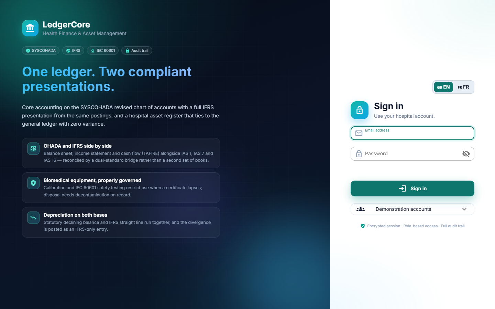
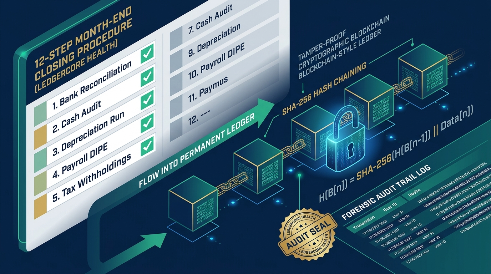
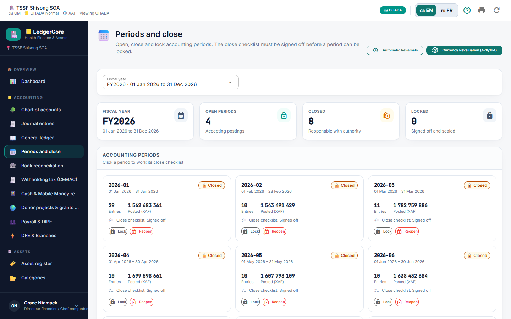

# LedgerCore Health — Role Guide: System Administrator
**System Deployment, RBAC Provisioning, Database Maintenance & Cryptographic Security**

---


*Figure 1: LedgerCore Health Dual-Standard Architecture — Unified Double-Entry Core connecting SYSCOHADA Revised (OHADA), IFRS Presentation, Biomedical Asset Lifecycle, and Hospital Cash Desks.*

---

## 1. System Deployment & Environment Setup


*Figure 2: Authentication Portal — Language Selection, Encrypted Session Handshake, and RBAC Profiles.*

LedgerCore Health operates as a high-performance decoupled architecture:
- ⚡ **Backend API:** Node.js (Express, ES Modules, MySQL2/MariaDB connection pool) on port `4700`.
- 🌐 **Frontend UI:** Python 3.10+ (NiceGUI, Quasar/Vue3, TailwindCSS) on port `8700`.
- 🗄️ **Database:** MariaDB 10.5+ / MySQL 8.0 on port `3306` (Database: `ledgercore`).

### Step-by-Step Procedure: Starting Services on Windows Server
1. 🗄️ **Database Service:** Ensure MariaDB / MySQL is running via Windows Services or XAMPP Control Panel.
2. ⚡ **Launch Backend API:**
   ```powershell
   cd "C:\Core Accounting and asset\backend"
   npm start
   ```
   *Health Check Verification:* Open `http://127.0.0.1:4700/api/health` — must return status `healthy`.
3. 🌐 **Launch Frontend Service:**
   ```powershell
   cd "C:\Core Accounting and asset\frontend"
   python main.py
   ```
   *UI Access:* Open `http://127.0.0.1:8700` in Google Chrome or Microsoft Edge.

---

## 2. Step-by-Step Procedure: User Provisioning & Granular RBAC Permissions

Under **Administration -> Users & Permissions** (`/users`):
1. 👤 Click **+ Add User**.
2. 📝 Enter email, full name, phone number, and default language (`en` or `fr`).
3. 🔑 Set the initial temporary password and enable **Force password change on first sign-in**.
4. 🛡️ Assign one or multiple role profiles:
   - `admin`: System configuration, organization settings, user management.
   - `cfo`: Full financial posting, period close, depreciation, and reporting.
   - `accountant`: Voucher preparation, lettrage, bank reconciliation.
   - `asset_manager`: Asset register, maintenance scheduling, physical inventory.
   - `biomed_tech`: Work order execution, IEC 60601 testing, calibration logging.
   - `services_tech`: Errands, shopping lists, vehicle fleet logs.
   - `ward_head`: Departmental asset view and breakdown ticket submission.
5. 💾 Click **Save User**.

---

## 3. Step-by-Step Procedure: Organization Settings & Statutory Posting Rules

Under **Administration -> Organization Settings** (`/settings`):
- 💱 **Functional Currency:** Default `XAF` (Central African CFA franc) or `XOF`.
- 📒 **Accounting Frameworks:** Select `OHADA`, `IFRS`, or `Both` (Dual-Standard Mode).
- 🔢 **Posting Length (Longueur des Comptes):** Set statutory account digits (4, 6, or 8 digits). Note: Once transactions exist, posting length is permanently locked to preserve historical audit integrity.
- ⏳ **Suspense Account (*Compte d'Attente*):** Default `471100` for unclassified banking receipts awaiting allocation.

---

## 4. Cryptographic Seal Verification & Forensic Audit Trail


*Figure 3: 12-Step Month-End Closing Procedure & Cryptographic SHA-256 Hash Chaining in LedgerCore Health.*


*Figure 4: Period Management Screen — Verifying Audit Seal Integrity and Permanent Chained Hashes.*

LedgerCore incorporates an immutable **SHA-256 blockchain-style seal** on journal entries:
- 🔗 Every posted entry hashes the previous entry's hash, timestamp, user ID, account lines, and monetary amounts.
- 🛡️ Under **Reporting -> Audit Seal Verification**, run the integrity scanner:
  - If any row in the `journal_entries` or `journal_lines` database table was altered outside the application (e.g., direct SQL injection or manual database update), the cryptographic verification fails immediately with the exact tampered row number highlighted in red.

---

## 5. Automated Database Backup & Disaster Recovery

### Automated Daily Dump (PowerShell Script):
```powershell
$Date = Get-Date -Format "yyyy-MM-dd_HH-mm"
$BackupFile = "C:\Backups\ledgercore_backup_$Date.sql"
mysqldump.exe -u root -p"your_password" --single-transaction --quick --routines --triggers ledgercore > $BackupFile
```

### Restoration Protocol:
```powershell
mysql.exe -u root -p"your_password" ledgercore < "C:\Backups\ledgercore_backup_2026-10-18.sql"
```
